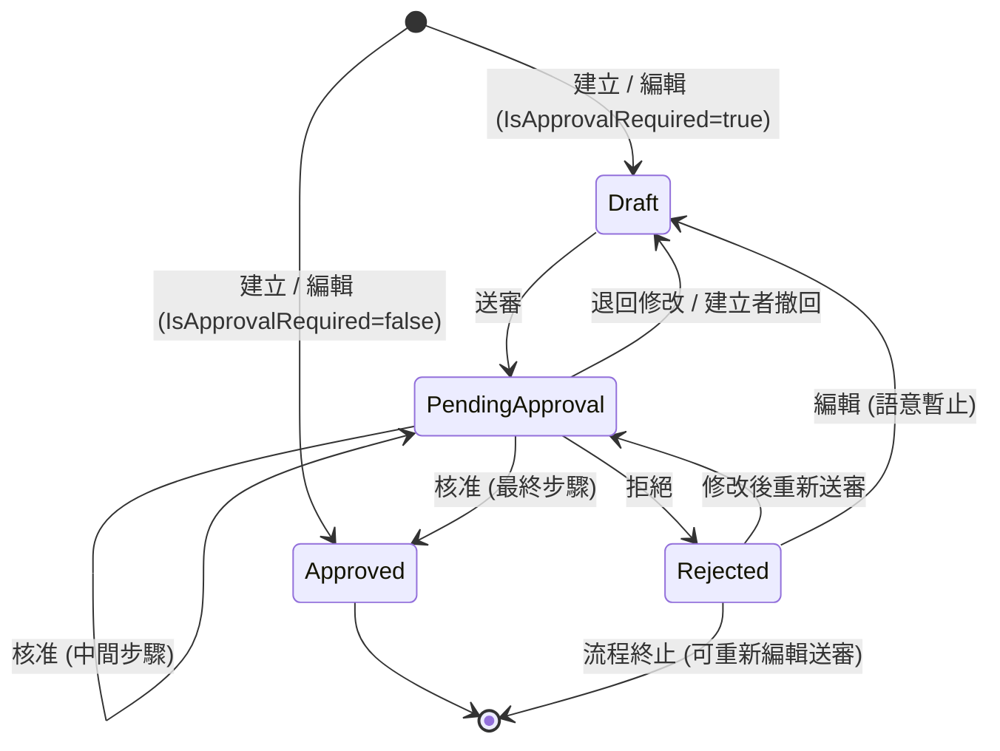

# 簽核流程模組 (Approval Workflow)

> **閱讀對象**：系統管理員、顧問開發者
> **適用版本**：v1.2（2026-05-20）
>
> **v1.2 變更摘要（功能擴充）**：
> - ✅ **Supervisor 自動解析**：依組織樹 `OrganizationUnit.ParentId` 自動找直屬主管，多人時取 UserName 字典序最小者
> - ✅ **`IApprovalSyncContributor` 註冊機制**：取代「每個 Controller 重複實作 sync-on-read」的舊模式，顧問模組只需註冊 DI 即可享有中央同步
> - ✅ **`CancelOnDelete` 服務方法**：業務文件刪除時自動撤回進行中的 ApprovalRequest 並寫入稽核 Log
> - GoodsShipment / SalesReturn 補完 sync-on-read（v1.1 漏網）
>
> **v1.1 變更摘要**（歷史紀錄；其中「未實作」敘述已被 v1.2 部分解除——Supervisor 自動解析已於 v1.2 實作，見上；「PendingApproval 刪除」現況見 §3 操作限制表附註）：
> - 補齊 ApprovalTemplate / ApprovalStep / ApprovalRequest 完整欄位定義
> - 新增 §2.6 ApprovalLog 資料模型
> - 重寫 §5.6 闡明 SyncSourceDocument 中央同步機制與 sync-on-read 策略
> - 修正 §5 範例中業務文件 PK 命名（`order.Id` → `order.PurchaseOrderId`）
> - §3 「PendingApproval 直接刪除」降級為 v1.0 未實作（需先撤回再刪除）
> - §7 明確標示 Supervisor 自動解析為 v1.0 未實作（須人工指派）
> - 新增 §10 限制與後續規劃 / §11 並發控制與冪等性 / §12 稽核與資料保護

---

## 目錄

1. [模組概述](#1-模組概述)
2. [核心資料模型](#2-核心資料模型)
3. [文件狀態流程](#3-文件狀態流程)
4. [管理員設定步驟](#4-管理員設定步驟)
5. [自訂作業畫面整合](#5-自訂作業畫面整合)
6. [簽核操作說明](#6-簽核操作說明)
7. [組織異動處理](#7-組織異動處理)
8. [服務介面參考](#8-服務介面參考)
9. [權限設定](#9-權限設定)
10. [限制與後續規劃](#10-限制與後續規劃)
11. [並發控制與冪等性](#11-並發控制與冪等性)
12. [稽核與資料保護](#12-稽核與資料保護)

---

## 1. 模組概述

簽核流程模組提供彈性的多步驟審核機制，可套用於任何自訂作業畫面。核心設計原則如下：

- **不須審核的作業**：按「儲存」即直接完成，無任何額外步驟
- **須審核的作業**：按「儲存」為「儲存草稿」，需由建立者手動送審後，依模板逐步完成簽核
- **依廠別設定**：同一作業類型在不同廠別可以有不同的審核規則（或不同模板）
- **組織異動保護**：可人工重新指派簽核人，不中斷進行中的流程

### 功能架構

```
┌──────────────────────────────────────────────────────┐
│  管理員設定層                                          │
│  ┌─────────────────┐  ┌────────────────────────────┐  │
│  │  簽核模板設定     │  │  作業類型簽核設定           │  │
│  │  (步驟 / 簽核人) │  │  (哪個作業須審核 / 套用模板)│  │
│  └─────────────────┘  └────────────────────────────┘  │
└──────────────────────────────────────────────────────┘
                    ↓ 套用
┌──────────────────────────────────────────────────────┐
│  作業執行層（自訂畫面）                               │
│  儲存草稿 → 送審 → 待審核 → 已核准 / 已退回          │
└──────────────────────────────────────────────────────┘
                    ↓ 產生
┌──────────────────────────────────────────────────────┐
│  簽核執行層                                           │
│  待我簽核（逐步） → 核准 / 拒絕 → 下一步 or 完成      │
└──────────────────────────────────────────────────────┘
```

---

## 2. 核心資料模型

### 2.1 DocumentApprovalConfig — 作業類型簽核設定

每廠別、每種作業類型只有一筆設定。

| 欄位 | 類型 | 說明 |
|------|------|------|
| `DocumentType` | string (100) | 內部鍵值，與自訂畫面程式碼對應，例如 `"PurchaseOrder"` |
| `DocumentTypeName` | string (200) | 顯示名稱，例如 `"請購單"` |
| `IsApprovalRequired` | bool | `true` = 須審核；`false` = 儲存即完成 |
| `ApprovalTemplateId` | string? | 套用的簽核模板（`IsApprovalRequired = true` 時必填） |
| `PlantId` | string? | 廠別（自動由 DbContext 填入） |

> **唯一約束**：同一廠別內，`DocumentType` 不可重複。

### 2.2 ApprovalTemplate — 簽核模板

定義審核流程的骨架，可在多個作業類型間共用。

| 欄位 | 類型 | 說明 |
|------|------|------|
| `Id` | string (GUID) | 模板主鍵 |
| `Name` | string | 模板名稱，例如 `"二級主管審核"` |
| `TargetDocumentType` | string? | 建議套用的作業類型代碼（顯示用，方便挑模板時過濾，例如 `"PurchaseOrder"`；可留空表示通用模板） |
| `Steps` | collection | 簽核步驟集合（依 Sequence 排序執行） |
| `PlantId` | string? | 廠別（IPlantEntity，自動由 DbContext 填入） |
| `CreatedByRoleId` | string? | 建立者角色（IDataAuthEntity，自動填入） |
| `OrganizationUnitPath` | string? | 建立者組織路徑（IDataAuthEntity，自動填入，受階層權限過濾） |

> **跨廠別策略**：模板儲存時帶 `PlantId`，**只能在同廠別使用**。若需要全公司共用模板，目前須在每個廠別各建立一份。

### 2.3 ApprovalStep — 簽核步驟

| 欄位 | 類型 | 說明 |
|------|------|------|
| `Id` | string (GUID) | 步驟主鍵 |
| `TemplateId` | string | 所屬模板 |
| `Sequence` | int | 執行順序（1 = 第一步） |
| `ApproverType` | enum | `Supervisor`（直屬主管）、`Role`（指定角色）、`User`（指定使用者） |
| `TargetRoleId` | string? | `ApproverType = Role` 時填入 |
| `TargetUserId` | string? | `ApproverType = User` 時填入 |
| `Condition` | string? | **v1.0 保留欄位，Service 不會評估**。資料庫保存但執行流程忽略，留待未來支援條件分歧 |

> **限制（v1.0）**：每個 Step 只能指定**單一**角色或使用者；不支援「A 或 B 任一人」「A 與 B 都需簽」「平行步驟」。相關規劃請見 [§10 限制與後續規劃](#10-限制與後續規劃)。

### 2.4 ApprovalRequest — 簽核申請單

每次送審會建立一筆，記錄整個流程進度。**撤回 / 拒絕 / 退回後重新送審會建立新一筆 ApprovalRequest**，舊筆永久保留作為歷史紀錄。

| 欄位 | 類型 | 說明 |
|------|------|------|
| `Id` | string (GUID) | 申請單主鍵，業務模型透過 `ApprovalRequestId` 引用 |
| `DocumentId` | string | 關聯文件 ID（依模組為 `PurchaseOrderId` / `SalesOrderId` 等字串 PK） |
| `DocumentType` | string | 關聯作業類型代碼，例如 `"PurchaseOrder"` |
| `CurrentStepId` | string | 目前等待簽核的步驟（已完成或終止狀態時為最後操作步驟） |
| `Status` | enum (int) | 見 [§2.4-A ApprovalStatus](#24-a-approvalstatus申請單--歷程層級) |
| `RequesterId` | string? | 送審人 UserId |
| `RequesterRoleId` | string? | 送審當下的角色 ID（審核流程依此判斷層級權限） |
| `ActiveApproverId` | string? | 快照簽核人（主管型步驟解析結果，或管理員 ReassignApprover 後的覆寫值） |
| `PlantId` | string? | 廠別（IPlantEntity，自動填入） |
| `CreatedByRoleId` | string? | 建立者角色（IDataAuthEntity，自動填入） |
| `OrganizationUnitPath` | string? | 組織路徑（IDataAuthEntity，自動填入，受階層權限過濾） |

### 2.4-A ApprovalStatus（申請單 / 歷程層級）

儲存於 `ApprovalRequest.Status` 與 `ApprovalLog.Action`，**資料庫以整數儲存**。

| 整數值 | 名稱 | 說明 |
|:------:|------|------|
| `0` | `Pending` | 待審核，申請單建立後的初始狀態 |
| `1` | `Approved` | 核准（單步驟核准，或最後一步核准時） |
| `2` | `Rejected` | 拒絕，整筆申請單永久終止 |
| `3` | `Withdrawn` | 建立者主動撤回 |
| `4` | `ReturnedForRevision` | 審核者退回修改，建立者可修改後重新送審 |

> **SQL 查詢範例**
> ```sql
> -- 查詢所有已核准的申請單
> SELECT * FROM "ApprovalRequests" WHERE "Status" = 1;
>
> -- 查詢所有歷程中曾被退回修改的記錄
> SELECT * FROM "ApprovalLogs" WHERE "Action" = 4;
> ```

### 2.5 DocumentApprovalStatus（文件層級）

此 enum 加在**自訂作業的資料模型**上，反映文件目前的審核狀態，供下游作業過濾使用。**資料庫以整數儲存**。

| 整數值 | 名稱 | 說明 | 建立者可操作 |
|:------:|------|------|:---:|
| `0` | `Draft` | 草稿，尚未送審（或被退回修改後） | 可編輯、可送審 |
| `1` | `PendingApproval` | 已送審，審核進行中 | 不可編輯（需先撤回） |
| `2` | `Approved` | 已核准，可供下游作業使用 | 不可編輯 |
| `3` | `Rejected` | 已拒絕，流程終止 | 可編輯、可重新送審 |

> **⚠ `Rejected` 與 `ReturnedForRevision` 的差異**
>
> | | `Rejected`（拒絕） | `ReturnedForRevision`（退回修改）|
> |--|--|--|
> | 發動者 | 審核者判定不通過 | 審核者要求修改後再送 |
> | 文件狀態 | `DocumentApprovalStatus = 3` | `DocumentApprovalStatus = 0`（Draft）|
> | 申請人可修改 | ✅（仍可修改） | ✅ |
> | 申請人可重新送審 | ✅ | ✅ |
> | 語意差異 | 此版本已被否決 | 需補件後重審 |
>
> **目前兩者在程式行為上相同**（皆可重新送審），差異在於審核歷程的記錄顯示與業務語意。

> **SQL 查詢範例**
> ```sql
> -- 下游作業：只撈已核准的單據（常用）
> SELECT * FROM "YourTable" WHERE "ApprovalStatus" = 2;
>
> -- 查詢待審核中的單據
> SELECT * FROM "YourTable" WHERE "ApprovalStatus" = 1;
>
> -- 查詢草稿或被拒絕（建立者需處理的）
> SELECT * FROM "YourTable" WHERE "ApprovalStatus" IN (0, 3);
> ```

### 2.6 ApprovalLog — 簽核歷程

每筆簽核動作（核准 / 退回 / 拒絕 / 撤回 / 重新指派）都會新增一筆 Log。**設計上不套 `IDataAuthEntity`** — 稽核紀錄須跨組織可查閱，僅以 `PlantId` 區隔廠別。

| 欄位 | 類型 | 說明 |
|------|------|------|
| `Id` | string (GUID) | Log 主鍵 |
| `RequestId` | string | 對應 ApprovalRequest |
| `ApproverId` | string | 操作者 UserId（撤回時為申請人；重新指派時為管理員） |
| `ApproverRoleId` | string | 操作者當下角色（重新指派 / 撤回時為空字串） |
| `Action` | enum (int) | 對應 `ApprovalStatus`：核准 = `Approved`、退回 = `ReturnedForRevision`、拒絕 = `Rejected`、撤回 = `Withdrawn`、重新指派 = `Pending`（透過 Comment 區辨） |
| `Comment` | string? | 意見 / 原因（重新指派時固定寫入：「重新指派簽核人：xxx｜原因：xxx」） |
| `ActionTime` | DateTime (UTC) | 時間戳 |
| `PlantId` | string? | 廠別（IPlantEntity，自動填入） |

> **稽核保護**：ApprovalLog 不會因組織異動或角色刪除而被清除；查詢請使用 [`ApprovalController.History`](Controllers/ApprovalController.cs) 端點。

---

## 3. 文件狀態流程

> 以下狀態圖為 GitHub-native mermaid 圖。若預覽器不支援 mermaid，可參考 [§3 ASCII 版本（附錄 A）](#附錄-a-文件狀態流程-ascii-備援)。



**審核動作對應關係**

| 審核者操作 | `ApprovalStatus`（歷程紀錄）| `DocumentApprovalStatus`（文件狀態）| 整數值對應 |
|------|:---:|:---:|:---:|
| 核准（最終步驟） | `Approved` | `Approved` | 申請 1 / 文件 2 |
| 核准（中間步驟） | `Approved` | `PendingApproval` | 申請 1 / 文件 1 |
| 退回修改 | `ReturnedForRevision` | `Draft` | 申請 4 / 文件 0 |
| 拒絕 | `Rejected` | `Rejected` | 申請 2 / 文件 3 |
| 建立者撤回 | `Withdrawn` | `Draft` | 申請 3 / 文件 0 |

### 各狀態下的操作限制

| 文件狀態 | 整數值 | 建立者可編輯 | 建立者可刪除 | 建立者可送審 | 建立者可撤回 |
|------|:---:|:-----------:|:-----------:|:-----------:|:-----------:|
| Draft | 0 | ✅ | ✅ | ✅ | — |
| PendingApproval | 1 | ❌（需先撤回） | ⚠ 依實作（見附註） | — | ✅ |
| Approved | 2 | ❌ | 依業務規則 | — | — |
| Rejected | 3 | ✅ | ✅ | ✅ | — |

> **✅ v1.2：待審核狀態的「自動取消流程」已支援（服務層能力）**
>
> **⚠ 2026-07-03 實況校正**：`CancelOnDelete` 為 v1.2 提供的**服務層選用能力**，目前**無生產 Controller 呼叫端**——
> 各模組現行主流實作採 CLAUDE.md「線上簽核防護規則」：`DeleteConfirmed` 檢查 `ApprovalStatus == PendingApproval` 時
> **拒絕刪除**並提示先撤回（部分交易單據另以業務條件擋刪，如已有進貨記錄）。新 Controller 若要允許
> 「刪除即自動取消簽核」，才依下述方式呼叫 `CancelOnDelete`；否則沿用拒絕刪除模式。
>
> Controller 在 `Delete` 動作中可呼叫 `IApprovalService.CancelOnDelete(requestId, userId, reason)`：
> - Pending 申請單會被標為 `Withdrawn` 並寫入稽核 Log（Comment 為「文件刪除自動取消」）
> - 不檢查呼叫者身分（與 `WithdrawRequest` 區隔）— 由 Controller 自行確認權限
> - 業務文件本體仍由 Controller 自行 `Remove`；本服務只處理 ApprovalRequest 終止
>
> ```csharp
> // Delete action 範例
> public async Task<IActionResult> Delete(string id)
> {
>     var po = await _context.PurchaseOrders.FindAsync(id);
>     if (po == null) return NotFound();
>     if (!string.IsNullOrEmpty(po.ApprovalRequestId))
>         await _approvalService.CancelOnDelete(po.ApprovalRequestId, _userContext.UserId!, "業務文件刪除");
>     _context.PurchaseOrders.Remove(po);
>     await _context.SaveChangesAsync();
>     return Ok();
> }
> ```

---

## 4. 管理員設定步驟

### 步驟一：建立簽核模板

路徑：**簽核管理 → 簽核模板設定**

1. 點「新增模板」，填入模板名稱
2. 進入模板，點「新增步驟」
3. 每個步驟設定：
   - **簽核者類型**：直屬主管 / 指定角色 / 指定使用者
   - **角色 / 使用者**（依類型選擇）
   - **條件**（選填，目前保留供未來擴充）
4. 可透過上下箭頭調整步驟順序
5. 可透過鉛筆圖示修改已建立的步驟

> **建議命名方式**：以審核層級命名，例如「一級主管審核」「跨部門二級審核」，方便不同作業類型共用模板。

### 步驟二：設定作業類型簽核規則

路徑：**簽核管理 → 作業類型簽核設定**

1. 點「新增設定」
2. 填入：
   - **作業名稱**：顯示用，例如 `請購單`
   - **作業類型代碼**：對應程式碼中的 `DocumentType` 字串，例如 `PurchaseOrder`
   - **是否需要審核**：勾選 = 須審核；不勾選 = 儲存即完成
   - **套用簽核模板**：從已建立的模板中選擇（需審核時必填）
3. 同一廠別內，每個作業類型代碼只能設定一次

> **注意**：作業類型代碼建立後**不可修改**（已與程式碼綁定），請謹慎命名。

---

## 5. 自訂作業畫面整合

### 5.1 資料模型加入審核欄位

```csharp
public class PurchaseOrder : IPlantEntity, IDataAuthEntity
{
    // ... 原有欄位 ...

    // 加入以下兩個欄位
    public DocumentApprovalStatus ApprovalStatus { get; set; } = DocumentApprovalStatus.Draft;
    public string? ApprovalRequestId { get; set; }
}
```

### 5.2 Controller 注入服務

```csharp
public class PurchaseOrderController : Controller
{
    private readonly ApplicationDbContext _context;
    private readonly UserManager<ApplicationUser> _userManager;
    private readonly IApprovalService _approvalService;

    public PurchaseOrderController(
        ApplicationDbContext context,
        UserManager<ApplicationUser> userManager,
        IApprovalService approvalService)
    {
        _context = context;
        _userManager = userManager;
        _approvalService = approvalService;
    }
}
```

### 5.3 儲存（Save as Draft or Direct Approve）

```csharp
[HttpPost, ValidateAntiForgeryToken]
public async Task<IActionResult> Create(PurchaseOrder model)
{
    var user = await _userManager.GetUserAsync(User);
    var config = await _approvalService.GetApprovalConfig("PurchaseOrder", user.PlantId);

    if (config?.IsApprovalRequired == true)
    {
        // 須審核 → 儲存草稿
        model.ApprovalStatus = DocumentApprovalStatus.Draft;
    }
    else
    {
        // 不須審核 → 直接核准
        model.ApprovalStatus = DocumentApprovalStatus.Approved;
    }

    _context.PurchaseOrders.Add(model);
    await _context.SaveChangesAsync();

    return RedirectToAction(nameof(Index));
}
```

### 5.4 送審（Submit for Approval）

```csharp
[HttpPost, ValidateAntiForgeryToken]
public async Task<IActionResult> Submit(string id)
{
    var order = await _context.PurchaseOrders.FindAsync(id);
    if (order == null) return NotFound();
    if (order.ApprovalStatus != DocumentApprovalStatus.Draft
        && order.ApprovalStatus != DocumentApprovalStatus.Rejected)
        return BadRequest("僅草稿或退回狀態可送審");

    var user = await _userManager.GetUserAsync(User);
    var config = await _approvalService.GetApprovalConfig("PurchaseOrder", user.PlantId);
    if (config?.ApprovalTemplateId == null)
        return BadRequest("此作業類型尚未設定簽核模板");

    var request = await _approvalService.SubmitForApproval(
        order.PurchaseOrderId, "PurchaseOrder", config.ApprovalTemplateId, user.Id);
    // ↑ 注意：第一個參數是業務文件的字串 PK（例如 PurchaseOrderId / SalesOrderId）
    //   各業務模組依實際 PK 欄位名稱替換；SubmitForApproval 內部以 string 儲存於 ApprovalRequest.DocumentId

    order.ApprovalRequestId = request.Id;
    order.ApprovalStatus = DocumentApprovalStatus.PendingApproval;
    await _context.SaveChangesAsync();

    return Json(new { success = true, message = "已送出審核" });
}
```

### 5.5 撤回（Withdraw）

```csharp
[HttpPost, ValidateAntiForgeryToken]
public async Task<IActionResult> Withdraw(string id)
{
    var order = await _context.PurchaseOrders.FindAsync(id);
    if (order == null) return NotFound();
    if (order.ApprovalStatus != DocumentApprovalStatus.PendingApproval)
        return BadRequest("僅待審核狀態可撤回");

    var user = await _userManager.GetUserAsync(User);

    // 撤回簽核申請
    var withdrawn = await _approvalService.WithdrawRequest(order.ApprovalRequestId!, user.Id);
    if (!withdrawn) return Json(new { success = false, message = "撤回失敗，請確認您是否為申請人" });

    // 回到草稿
    order.ApprovalStatus = DocumentApprovalStatus.Draft;
    order.ApprovalRequestId = null;
    await _context.SaveChangesAsync();

    return Json(new { success = true, message = "已撤回，資料回到草稿狀態" });
}
```

### 5.6 審核結果回寫（Approved / Rejected）

簽核人在「待我簽核」完成簽核後，`ApprovalService.ProcessApproval()` 會更新 `ApprovalRequest.Status` 並透過中央同步機制回寫業務文件的 `ApprovalStatus`。

#### 中央同步機制（v1.2）

`SyncSourceDocument` 內部執行順序：

1. **優先**查 DI 注入的 `IEnumerable<IApprovalSyncContributor>`，找 `DocumentType` 匹配的 contributor 並執行 `SyncAsync`
2. **fallback** 至 Core 內建的 switch 表（目前內建 `CodeEntry`）
3. 都沒匹配時不動作，不會擲例外

| DocumentType | v1.2 起的處理方式 |
|--------------|:--|
| `CodeEntry` | Core 內建 switch（含 `IsActive` 啟用旗標）|
| `PurchaseRequest` / `PurchaseOrder` / `GoodsReceipt` / `GoodsReturn` | 顧問模組註冊 IApprovalSyncContributor |
| `SalesOrder` / `SalesReturn` / `GoodsShipment` / `InternalOrder` | 同上 |
| `StockTransfer` / `CrossPlantTransfer` / `ScrapDoc` / `LoanDoc` / `SampleDoc` / `ReworkMaterialDoc` / `OutsourceMaterialDoc` / `StockAdjustment` | 同上 |
| 任何其他 DocumentType | 顧問自定 IApprovalSyncContributor，或保留 Controller sync-on-read 也行 |

#### 顧問模組整合方式（v1.2 推薦）

**步驟 1 — 實作 IApprovalSyncContributor**

```csharp
using SmartFactory.MES.Data;
using SmartFactory.MES.Models;
using SmartFactory.MES.Services;

namespace MyConsultantApp.Modules.PUR.Services;

public class PurchaseOrderApprovalSync : IApprovalSyncContributor
{
    public string DocumentType => "PurchaseOrder";

    public async Task SyncAsync(ApplicationDbContext db, string documentId,
        ApprovalStatus finalStatus, CancellationToken ct = default)
    {
        var po = await db.PurchaseOrders.IgnoreQueryFilters()
            .FirstOrDefaultAsync(p => p.PurchaseOrderId == documentId, ct);
        if (po == null) return;

        po.ApprovalStatus = finalStatus switch
        {
            ApprovalStatus.Approved            => DocumentApprovalStatus.Approved,
            ApprovalStatus.Rejected            => DocumentApprovalStatus.Rejected,
            ApprovalStatus.ReturnedForRevision => DocumentApprovalStatus.Draft,
            ApprovalStatus.Withdrawn           => DocumentApprovalStatus.Draft,
            _                                  => po.ApprovalStatus
        };
        if (po.ApprovalStatus == DocumentApprovalStatus.Draft)
            po.ApprovalRequestId = null;
    }
}
```

> Service 已開啟交易；contributor 內**不要**呼叫 `SaveChangesAsync`（由 ApprovalService 統一存檔）。

**步驟 2 — 在模組 RegisterServices 中註冊**

```csharp
// Modules/PUR/PurModule.cs
public class PurModule : IAppModule
{
    public void RegisterServices(IServiceCollection services, IConfiguration config)
    {
        services.AddScoped<IApprovalSyncContributor, PurchaseOrderApprovalSync>();
        services.AddScoped<IApprovalSyncContributor, GoodsReceiptApprovalSync>();
        // ... 其他文件型別
    }
}
```

> 同一 DocumentType 註冊多個 contributor 時，會以「DI 解析順序的第一個」為準（建議避免）。

#### 何時仍需要 Controller sync-on-read？

雖然 v1.2 已提供中央同步，下列情境**仍建議搭配** sync-on-read：

| 情境 | 原因 |
|------|------|
| 業務文件被外部系統 / DB script 直接更新 ApprovalRequest | 中央同步只在 Service 呼叫路徑觸發 |
| 對 Index 清單顯示即時性要求高 | 中央同步只更新單張文件；其他文件仍有時間差 |
| 過渡期：Contributor 尚未實作完成的 DocumentType | 給予暫時的回寫機制 |

sync-on-read 範例（Index 批次模式）：

```csharp
public async Task<IActionResult> Index(...)
{
    var orders = await _context.PurchaseOrders.ToListAsync();
    var requestIds = orders.Where(o => o.ApprovalRequestId != null)
        .Select(o => o.ApprovalRequestId!).ToList();

    var requests = await _context.ApprovalRequests
        .Where(r => requestIds.Contains(r.Id)).AsNoTracking()
        .ToDictionaryAsync(r => r.Id);

    bool dirty = false;
    foreach (var order in orders)
    {
        if (order.ApprovalRequestId == null) continue;
        if (!requests.TryGetValue(order.ApprovalRequestId, out var req)) continue;
        var newStatus = req.Status switch
        {
            ApprovalStatus.Approved            => DocumentApprovalStatus.Approved,
            ApprovalStatus.Rejected            => DocumentApprovalStatus.Rejected,
            ApprovalStatus.ReturnedForRevision => DocumentApprovalStatus.Draft,
            ApprovalStatus.Withdrawn           => DocumentApprovalStatus.Draft,
            _ => order.ApprovalStatus
        };
        if (newStatus != order.ApprovalStatus)
        {
            order.ApprovalStatus = newStatus;
            if (newStatus == DocumentApprovalStatus.Draft)
                order.ApprovalRequestId = null;
            dirty = true;
        }
    }
    if (dirty) await _context.SaveChangesAsync();
    // ... 回傳 view
}
```

#### 撤回 / 退回的狀態回寫

`WithdrawRequest` 與 `ReturnedForRevision` 的回寫**仍須由 Controller 自行處理**（Service 端不會回寫業務文件）：

```csharp
// Withdraw action 範例
var withdrawn = await _approvalService.WithdrawRequest(order.ApprovalRequestId!, user.Id);
if (!withdrawn) return Json(new { success = false, message = "撤回失敗" });

order.ApprovalStatus = DocumentApprovalStatus.Draft;
order.ApprovalRequestId = null;
await _context.SaveChangesAsync();
```

### 5.7 下游作業過濾

下游作業只顯示「已核准」的資料：

```csharp
var availableOrders = await _context.PurchaseOrders
    .Where(o => o.ApprovalStatus == DocumentApprovalStatus.Approved)
    .ToListAsync();
```

---

## 6. 簽核操作說明

### 6.1 簽核人：待我簽核

路徑：**簽核管理 → 待我簽核**

系統依「目前步驟的 `ApproverType`」與「申請單的 `ActiveApproverId`」決定該筆是否出現在使用者的待簽清單中。**`ActiveApproverId` 已設值時優先以它判斷**，否則回到步驟的 `TargetRoleId / TargetUserId` 比對。

| Step 的 ApproverType | `ActiveApproverId` 為空 | `ActiveApproverId` 已設定（指派 / Supervisor 解析後）|
|---------------------|-----------------------|---------------------------------------|
| `Role` | 比對使用者 `ActiveRoleId == step.TargetRoleId` | 比對 `userId == ActiveApproverId` |
| `User` | 比對使用者 `userId == step.TargetUserId` | 比對 `userId == ActiveApproverId` |
| `Supervisor` | **沒有人能看到此申請單**（必須先指派 / 解析）| 比對 `userId == ActiveApproverId` |

簽核動作：點「審核」按鈕，在側邊面板填寫意見並選擇：
- **核准**：推進到下一步；最後一步完成則整筆核准
- **退回修改**：流程暫停，文件退回 Draft 狀態，申請人可修改後重新送審
- **拒絕**：整筆申請單永久終止，文件狀態變為 Rejected，**不可重新送審**

### 6.2 管理員：所有簽核記錄

路徑：**簽核管理 → 所有簽核記錄**（Admin / Manager）

功能：
- 依狀態、作業類型篩選（含「已撤回」狀態）
- 查看簽核歷程
- 針對「待審核」狀態的申請單，重新指派簽核人（詳見第 7 節）

---

## 7. 組織異動處理

> **✅ v1.2：直屬主管型步驟支援自動解析**
> `ApproverType.Supervisor` 步驟在送審 / 推進時，Service 會依下列演算法自動填入 `ActiveApproverId`：
>
> 1. 申請者的 `ActiveRoleId` → `Role.OrganizationUnitId`
> 2. 該 OrganizationUnit 的 `ParentId` → Parent OU
> 3. 掛在 Parent OU 上的所有 Role
> 4. 將 `ActiveRoleId` 屬於上述 Role 的 User 中，**取 UserName 字典序最小者**填入 `ActiveApproverId`
>
> 若任一步找不到（無 Parent / Parent 無 Role / Role 無 active user），`ActiveApproverId` 保持為 null，**fallback 至人工指派流程**（管理員透過 ReassignApprover 介入）。
>
> **解析後的稽核 Log**：自動解析的結果**不會**額外寫入 ApprovalLog；只記錄於 ApprovalRequest 本身，並透過 `ILogger` 記錄到 application log。日後管理員 ReassignApprover 時才會寫入正式稽核紀錄。

### 問題場景

```
送審時：Step 2 指定「角色：品管主管」→ 由 張三 擔任
審核進行到 Step 2 時：組織改版，品管主管已換為 李四
→ 張三無此角色無法在待我簽核看到此申請單
→ 李四尚未登入系統，不知道有待簽案件
```

### 各簽核者類型的影響

| 簽核者類型 | 組織異動影響 | 處理方式 |
|-----------|------------|---------|
| **指定角色** | 低影響：新成員加入角色後即可簽核 | 通常不需處理 |
| **指定使用者** | 高影響：特定人員若已離職或換崗，無人可簽 | 需管理員重新指派 |
| **直屬主管** | 中影響：自動解析依「角色 → OU → ParentId → 上層 Role 之 active user」推導 | v1.2 起自動解析；組織異動後若主管已換人，仍需 ReassignApprover 介入既有 Pending 申請單 |

### 重新指派步驟

1. 路徑：**簽核管理 → 所有簽核記錄**
2. 找到狀態為「待審核」的申請單
3. 點右側「指派簽核人」按鈕（`⚙` 圖示）
4. 選擇新的簽核人，填寫原因（例如：`組織改版 2026-03`）
5. 確認後，新簽核人的「待我簽核」清單即會出現此申請單

> **注意**：重新指派會**覆寫** `ActiveApproverId`，適用於所有步驟類型。
> 指派動作會記錄至簽核歷程（ApprovalLog），可查詢稽核軌跡。

---

## 8. 服務介面參考

### 8.1 IApprovalService — 主流程

```csharp
public interface IApprovalService
{
    /// <summary>取得指定作業類型的簽核設定（含模板）</summary>
    Task<DocumentApprovalConfig?> GetApprovalConfig(string documentType, string? plantId);

    /// <summary>建立簽核申請單，回傳申請單（含 Id 供記錄於文件上）。
    /// Supervisor 型首步驟會自動解析 ActiveApproverId（v1.2+）。</summary>
    Task<ApprovalRequest> SubmitForApproval(
        string documentId, string documentType, string templateId, string requesterId);

    /// <summary>簽核人執行核准 / 拒絕 / 退回修改。
    /// 推進到 Supervisor 步驟時，會自動解析下一位 ActiveApproverId（v1.2+）。
    /// 終局狀態（Approved/Rejected/ReturnedForRevision）會觸發 SyncSourceDocument 回寫業務文件。</summary>
    Task<bool> ProcessApproval(
        string requestId, string approverId, string roleId,
        ApprovalStatus action, string? comment);

    /// <summary>建立者撤回待審核申請（僅限申請人本人）。寫入稽核 Log（Action=Withdrawn）。</summary>
    Task<bool> WithdrawRequest(string requestId, string requesterId);

    /// <summary>管理員重新指派簽核人（組織異動 / 主管解析失敗時介入）。
    /// 覆寫 ActiveApproverId 並寫入稽核 Log（Action=Pending + Comment 註記）。</summary>
    Task<bool> ReassignApprover(
        string requestId, string newApproverId, string operatorId, string? reason);

    /// <summary>v1.2+：業務文件刪除時連動取消其進行中的簽核申請。
    /// 將 Pending 申請單設為 Withdrawn 並寫入稽核 Log；非 Pending 狀態回 false。
    /// 與 WithdrawRequest 不同：不檢查呼叫者身分，由 Controller 自行確認權限。</summary>
    Task<bool> CancelOnDelete(string requestId, string operatorId, string? reason);
}
```

### 8.2 IApprovalSyncContributor — 中央同步擴充點（v1.2+）

顧問模組為自家業務文件實作此介面，再以 `services.AddScoped<IApprovalSyncContributor, MySync>()` 註冊即可。

```csharp
public interface IApprovalSyncContributor
{
    /// <summary>處理哪一種 DocumentType（與 SubmitForApproval 傳入的 documentType 對應）</summary>
    string DocumentType { get; }

    /// <summary>回寫業務文件狀態。finalStatus 為終局 ApprovalStatus；不處理 Pending。
    /// 注意：本方法執行於 ApprovalService 的交易內，不要呼叫 SaveChangesAsync。</summary>
    Task SyncAsync(ApplicationDbContext db, string documentId, ApprovalStatus finalStatus, CancellationToken ct = default);
}
```

實作範例見 [§5.6 顧問模組整合方式](#56-審核結果回寫approved--rejected)。

---

## 9. 權限設定

| 功能畫面 | MenuKey | 建議開放角色 |
|---------|---------|------------|
| 待我簽核 | `PendingApprovals` | 所有角色（依簽核步驟自動過濾） |
| 所有簽核記錄 | `AllApprovalRequests` | Admin、Manager |
| 簽核模板設定 | `ApprovalTemplateSetting` | Admin |
| 作業類型簽核設定 | `DocumentApprovalConfig` | Admin |

> 透過 **管理員設定 → 權限設定** 為各角色開放對應的 MenuKey。

**「重新指派簽核人」的雙層權限控管：**

| 層級 | 機制 | 說明 |
|------|------|------|
| 畫面層 | `PermissionService.CanUpdate("AllApprovalRequests")` | 無此權限的使用者看不到指派按鈕 |
| Controller 層 | `[Authorize(Roles = "Admin,Manager")]` | 即使直接呼叫 API，非 Admin/Manager 也會被拒絕 |

兩層均需通過，後端為最終防線。

> **⚠ Manager 角色注意事項**
> 系統 seed 預設只建立 `Admin` 角色。若要啟用 `Manager` 的差異化權限，請先於「角色管理」中建立 `Manager` 角色並指派使用者。
> 若不建立 `Manager` 角色，所有 `[Authorize(Roles = "Admin,Manager")]` 端點等同 **Admin only**。

---

## 10. 限制與後續規劃

### 10.1 v1.2 為止已知限制

下列是 **v1.2 為止已知尚未實作**的功能。標 ✅ 者為 v1.2 已解除（保留紀錄供版本追溯）。

| # | 限制 | 狀態 | 暫行解決方案 |
|---|------|:----:|------------|
| 1 | `ApproverType.Supervisor` 自動解析 | ✅ v1.2 已支援 | — |
| 2 | `ApprovalStep.Condition` 欄位不被執行 | ⚠ 未實作 | 設計流程時避免條件邏輯，需要時拆成多個模板 |
| 3 | 不支援多人簽核（A 或 B / A 且 B / 平行）| ⚠ 未實作 | 拆成連續多個 Step |
| 4 | 中央同步 `SyncSourceDocument` 擴充點 | ✅ v1.2 已支援 `IApprovalSyncContributor` | — |
| 5 | 待審核狀態的「自動取消流程」 | ✅ v1.2 已支援 `CancelOnDelete` | — |
| 6 | 無並發控制（樂觀鎖）| ⚠ 未實作 | 業務角度可接受（最後寫入勝出）；詳見 [§11](#11-並發控制與冪等性) |
| 7 | ApprovalTemplate / DocumentApprovalConfig 引用未檢查 | ⚠ 未實作 | 管理員操作前手動確認沒有進行中申請單 |
| 8 | 模板不支援跨廠別共用 | ⚠ 未實作 | 在每個廠別各建一份；用統一命名規則便於辨識 |

### 10.2 Roadmap

> **⚠ 版本標籤說明**：v1.0 ~ v1.2 為已落地的版本（有對應 commit / 測試）。下方 `vNext-A` / `vNext-B` / `vNext-C` 為**功能群組占位標籤**，依優先級分組，**尚未經正式排程與業務負責人核可**；版本號待實際安排時再行指派。

#### 已完成
| 版本 | 範圍 | 狀態 |
|------|------|:----:|
| **v1.2** | Supervisor 自動解析（依 `OrganizationUnit.ParentId` 樹狀關係） | ✅ 已完成 |
| **v1.2** | `IApprovalService.CancelOnDelete(requestId, userId, reason)` | ✅ 已完成 |
| **v1.2** | `IApprovalSyncContributor` 註冊機制，集中 SyncSourceDocument | ✅ 已完成 |

#### 規劃中（待正式排程）

**vNext-A — 多人簽核與條件分歧**（解除 §10.1 #2、#3）
| 範圍 | 描述 |
|------|------|
| 多人簽核（任一人 / 全員 / N 人通過）| ApprovalStep 加 `ApprovalMode` 欄位；PendingIndex 過濾邏輯擴充 |
| `ApprovalStep.Condition` DSL 表達式評估 | 支援 `Amount > 1000`、`TypeCode = 'IJ'` 等條件分歧 |

**vNext-B — 資料一致性與並發**（解除 §10.1 #6、#7）
| 範圍 | 描述 |
|------|------|
| `ApprovalRequest` 並發控制（RowVersion / xmin）| 兩位簽核者同時操作時拋出 ConcurrencyException |
| ApprovalTemplate / DocumentApprovalConfig 使用中引用檢查 | 套用 CodeEntry pattern 的 `ICodeEntryReferenceChecker` 模式 |

**vNext-C — 平行流程與全域模板**（解除 §10.1 #8）
| 範圍 | 描述 |
|------|------|
| 平行步驟與委派 | 同一申請單多個 Step 同時待簽；簽核人可委派給另一人 |
| 跨廠別共用模板（`PlantId = null` 表示全域）| 模板無 PlantId 時，所有廠別共用 |

---

## 11. 並發控制與冪等性

### 11.1 v1.0 並發行為

當前實作**沒有**對 `ApprovalRequest` 加上樂觀鎖（無 RowVersion / xmin concurrency token）。

| 情境 | 行為 |
|------|------|
| 同一申請單兩位合格簽核者同時點「核准」 | 兩個 ProcessApproval 都會建立 ApprovalLog 記錄；最後寫入的 Status / CurrentStepId 勝出 |
| 簽核人 A 核准的同時，建立者 B 點撤回 | 較晚寫入的勝出（Approved 或 Withdrawn）；ApprovalLog 兩筆皆保留 |
| 管理員 ReassignApprover 同時，前一位指派的簽核人點核准 | ActiveApproverId 與 Status 可能脫節，但 Log 完整保留 |

### 11.2 冪等性說明

| 端點 | 冪等性 | 重試行為 |
|------|:-:|---------|
| `SubmitForApproval(documentId, ...)` | ❌ | 重複呼叫會建立**多筆** ApprovalRequest（應由 Controller 端先檢查 `ApprovalRequestId` 是否已存在） |
| `ProcessApproval(requestId, ...)` | ❌ | 已終止狀態（Approved / Rejected / Withdrawn / ReturnedForRevision）的申請單會回 `false`，視同無效；但若於 Pending 狀態被同時呼叫兩次會雙寫 Log |
| `WithdrawRequest(requestId, requesterId)` | ⚠ | 已撤回再撤回回 `false`，安全 |
| `ReassignApprover(requestId, ...)` | ⚠ | 已終止狀態回 `false`；Pending 狀態多次呼叫各自寫 Log |
| `GetApprovalConfig(documentType, plantId)` | ✅ | 唯讀 |

### 11.3 建議

業務情境若對並發敏感（例如金額大的採購單），建議：
1. 前端送出按鈕加 throttle / 灰化
2. v1.2 規劃在 `ApprovalRequest` 加 `[ConcurrencyCheck]` RowVersion
3. 或在 Controller 層用 `IDistributedLock` 同步單一申請單操作

---

## 12. 稽核與資料保護

### 12.1 ApprovalLog 設計意圖

**不套 `IDataAuthEntity`**：稽核紀錄須跨組織可查閱，僅以 `PlantId` 過濾廠別。

| 影響 | 行為 |
|------|------|
| 跨部門查詢 | 任何能 Read `AllApprovalRequests` 的使用者，皆可看到該廠別內所有簽核歷程 |
| 組織異動 | 歷史 Log 不會因建立者離職、角色刪除而消失 |
| 跨廠別隔離 | `PlantId` global query filter 仍會套用，不會洩漏到其他廠別 |

### 12.2 ApprovalRequest 階層權限影響

**有套 `IDataAuthEntity`**：申請單只有「申請者組織路徑前綴覆蓋者」能在 Pending Index 看到。

> **使用情境差異**：
> - 主管看下屬送的單 → ✅ 自動可見（OrganizationUnitPath 階層覆蓋）
> - 跨部門協作 / 臨時調動 → ⚠ 申請單初始 OrganizationUnitPath 鎖定送審當下的部門，後續調動到別部門也看不到（除非用 ReassignApprover 介入）

### 12.3 保留與刪除

| 資料表 | 保留政策 | 備註 |
|--------|---------|------|
| `ApprovalRequest` | 永久保留 | 撤回後不刪除，狀態變 Withdrawn |
| `ApprovalLog` | 永久保留 | 不提供刪除 API |
| `ApprovalTemplate` | 可刪除 | v1.0 未檢查使用中引用，請手動確認 |
| `DocumentApprovalConfig` | 可刪除 | 同上 |

### 12.4 個資合規（GDPR-like）注意事項

- `ApprovalLog.ApproverId` / `ApprovalRequest.RequesterId` 為 UserId（內部 GUID），離職後 User 記錄保留時無個資外洩風險
- 若離職後實際刪除 ApplicationUser 記錄，Log 仍會保留 ApproverId 字串值，可能造成「孤兒 ID」；建議停用而非刪除 User
- 顧問如需匯出簽核紀錄供稽核，可使用「所有簽核記錄」畫面的 Export 功能（依模板規範實作 xlsx 匯出）

---

## 附錄 A：文件狀態流程 ASCII 備援

若預覽環境不支援 mermaid，可參考此 ASCII 圖：

```
[建立 / 編輯]
      │
      ├─ IsApprovalRequired = false ──→ Approved（直接完成）
      │
      └─ IsApprovalRequired = true ──→ PendingApproval（儲存即送審）
                                            │
                                       ┌────┼────────┐
                             [核准]        [退回修改]   [拒絕]
                               │              │          │
                          還有下一步？       Draft      Rejected
                           ├── 是 ──→ PendingApproval  （流程終止）
                           └── 否 ──→ Approved
                                        （全部通過）
                         ↑
                  [建立者：撤回]（僅 PendingApproval 狀態可撤回）
                         │
                        Draft
```
